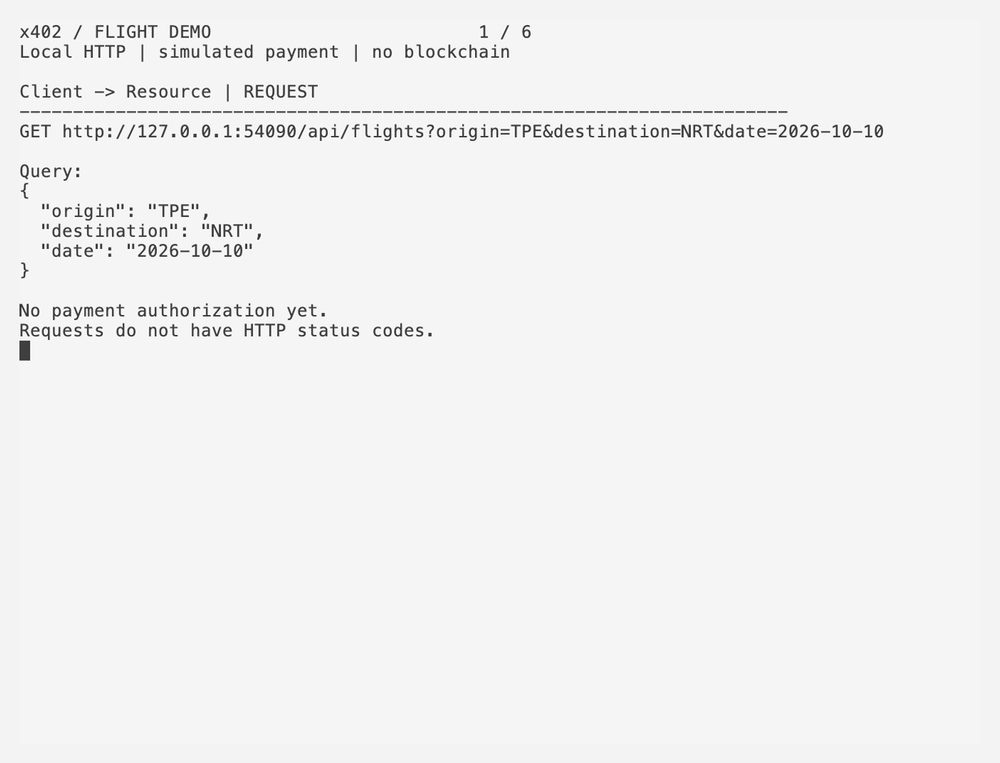
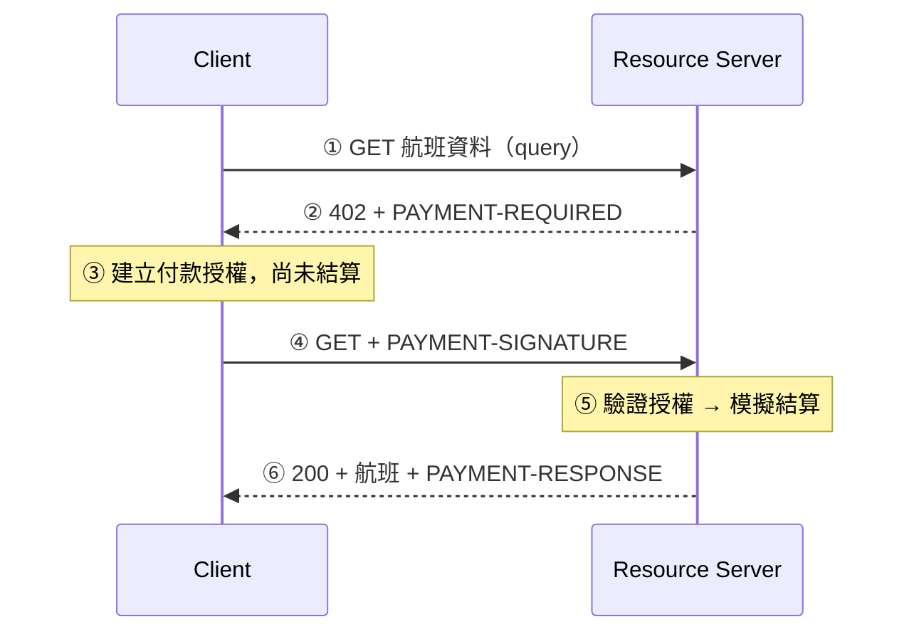
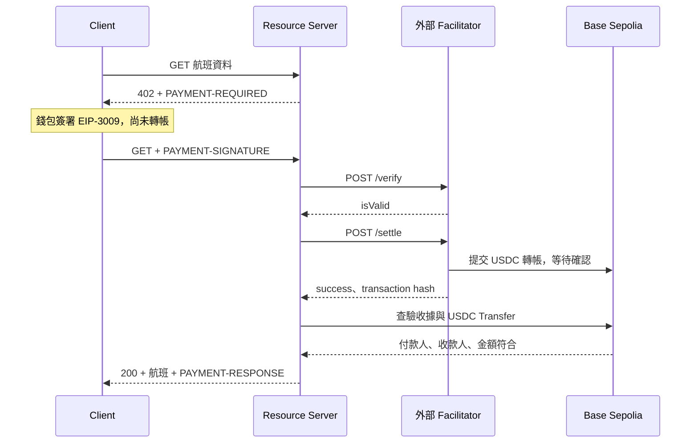
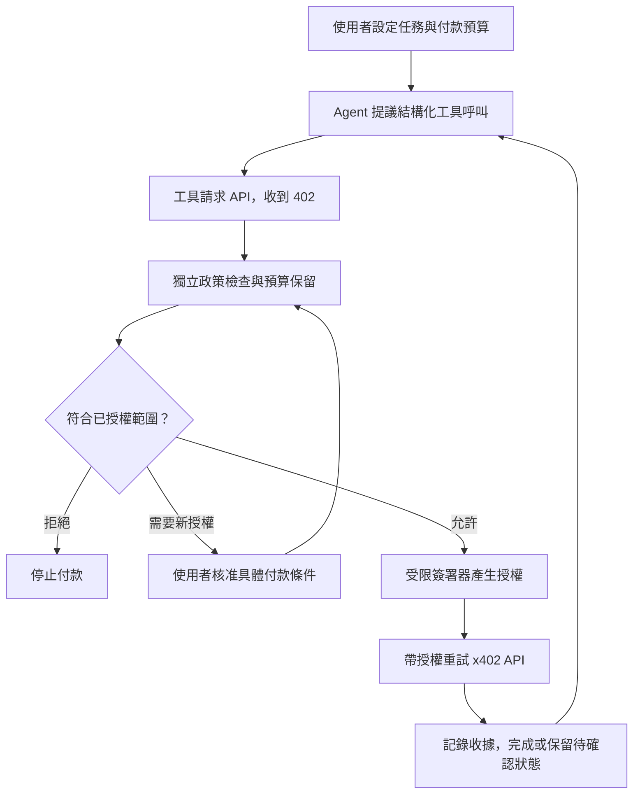

# x402 流程教學：從 HTTP 402 到 AI Agent 付款

[](https://docs.x402.org/)

[](LICENSE)

本專案以航班查詢 API 為範例，透過實際的 HTTP 請求，逐步展示 **查詢 → 付款條件 → Client 授權 → 驗證與結算 → 資料交付** 的完整流程。網站會依序呈現各階段的實際 Payload，README 則進一步介紹 x402 協定角色、AI Agent 付款架構及相關延伸學習資源。

專案預設使用 Demo 模式，無須連接錢包或發送鏈上交易，也可切換至 Base Sepolia 測試網進行實際結算。航班資訊採用固定測試資料，僅供流程展示，不提供訂位功能。

目前實作以 **x402 v2 的 EVM `exact` 付款模式與 EIP-3009** 為核心；AI Agent、ERC-8004、ERC-8196 及 Permit2 則作為延伸學習內容，尚未納入 Demo 實作。

## 建議學習順序

1. [操作 Demo](#start)：觀察第一次 402、Client 授權與最後的 200。
2. [讀懂流程與 payload](#flow)：分清 request、response、簽署、verify、settle。
3. [了解 AI agent 如何付款](#agent-payment)：工具呼叫、支出政策與受限簽署器。
4. [比較相關標準](#standards)：x402、ERC-8004、ERC-8196、EIP-3009、Permit2 各處理什麼問題。
5. [延伸資源](#resources)：官方文件、範例與安全架構研究。

## Terminal 示範

**[▶ 觀看 MP4 清晰版（約 30 秒）](docs/terminal-demo.mp4)**

GIF 預覽




影片透過實際的本機 HTTP 請求展示完整流程，其中授權與結算環節採用模擬方式呈現。付款 Header 會以 Base64 解碼後的 JSON 格式展示，航班資訊則精簡為主要欄位，全程不涉及實際的鏈上交易。

<a id="start"></a>

## 開始操作

需要 Node.js 22.9 以上。

```sh
npm install
cp .env.example .env.local
npm run dev
```

已有 `.env.local` 時不要覆蓋。開啟 http://127.0.0.1:3000 ，依序按「查詢航班 → 建立授權 → 結算取得資料」。在「目前步驟」回看每次呼叫的 query、headers／body 與回應。網站的 `/learn` 提供精簡學習導引。Ctrl+C 停止兩個服務。

| 模式 | Client 授權 | Resource 處理 | 結果 |
| --- | --- | --- | --- |
| Demo（預設） | 本機模擬簽章 | 內部模擬 verify／settle | 200 + 航班，`confirmed: false` |
| Base Sepolia | 錢包簽署 EIP-3009 | 外部 Facilitator 驗證／結算，再查驗鏈上收據 | 確認 USDC Transfer 後回傳 200 |

測試網：在 `.env.local` 設定 `X402_PAY_TO` 收款公開地址，重啟並切換模式。使用有 EVM 錢包擴充功能的瀏覽器，從 [Circle faucet](https://faucet.circle.com/) 領取 Base Sepolia 測試 USDC。簽署授權尚未轉帳；第三步「上鏈支付」會提交真實測試網付款。頁面會顯示 transaction hash 與 BaseScan 連結。

設定見 [.env.example](.env.example)：`X402_AMOUNT=10000` 表示 0.01 USDC，另可設定 port、服務 URL、RPC 與動畫延遲。私鑰留在錢包，不寫進 env。`X402-Mode: mock | testnet` 是本專案的模式選擇 header，不屬於 x402 標準。

<a id="flow"></a>

## x402 的流程與角色

### 先看 Demo



| 步驟 | 內容 | 作用 |
| --- | --- | --- |
| 查詢 | `GET` + `origin`／`destination`／`date` | Client 請求資源；request 沒有狀態碼 |
| 付款條件 | **response 402** + `PAYMENT-REQUIRED` | 宣告 `scheme`、`network`、`amount`、`asset`、`payTo`、有效期限等 |
| 建立授權 | Client 內部操作 | 依核准條件產生簽章；不是 HTTP 回應，也不是已轉帳 |
| 重試 | 相同資源 + `PAYMENT-SIGNATURE` | header 裝入 base64 編碼的 `PaymentPayload`；等待處理 |
| 驗證／結算 | `paymentPayload` + `paymentRequirements` | verify 檢查授權；settle 才執行付款 |
| 資料交付 | **response 200** + 航班 + `PAYMENT-RESPONSE` | 回傳資源與結算結果 |

三個付款 header 是 base64 編碼的 JSON，不是加密。`PAYMENT-SIGNATURE` 裝的是整份付款 payload，不只是簽章字串。[官方 Client／Server 說明](https://docs.x402.org/core-concepts/client-server)、[官方協定與規格](https://github.com/x402-foundation/x402/tree/main/specs)。

### 再看真實結算



帶授權的 GET 保持等待，verify、settle 和收據確認發生在這段等待期間。verify 的 HTTP 200 只代表 API 正常回應，仍要看 `isValid`；settle 要看 `success` 與交易結果。鏈上收據查詢不是再次轉帳。本專案額外查驗符合的 USDC Transfer，確認後才交付資料。

**Facilitator 協助驗證與結算，不是 API gateway。** x402 不要求獨立 gateway；Resource 可選擇自行處理付款。本專案只有 Client（Next.js，3000）與 Resource（3001）兩個本機 server，付款模組在 Resource 內；上鏈時才呼叫外部 Facilitator。
[官方 Facilitator 說明](https://docs.x402.org/core-concepts/facilitator)。

<a id="agent-payment"></a>

## AI agent 如何執行 payment？

對 x402 而言，AI agent 也是 Client。模型提出「需要這個 API」，由程式中的工具與付款 client 處理 402、選擇付款條件、取得簽章與重試。官方的 [Buyer quickstart](https://docs.x402.org/getting-started/quickstart-for-buyers) 可先用來理解程式化付款；本 Demo 由人按按鈕，沒有 agent runtime。

以下是延伸設計範例：



1. **模型提出需求**：例如 `searchFlights({ origin, destination, date })`，不要讓任意文字直接指定錢包私鑰或變更付款政策。
2. **工具取得報價**：解析 402，將 API 網域、資源、網路、代幣、收款人、金額與有效期限交給獨立政策層。
3. **政策層決定能否付**：檢查允許清單、單次／累計預算；先原子保留預算，避免並行工具各自花掉同一份額度。未授權的付款交給人核准。
4. **簽署器簽署**：使用受限錢包／簽署服務執行已核准的條件。模型不需要取得私鑰；遠端簽署器也要自行執行政策，不能只相信模型傳來的「已核准」。
5. **付款 client 重試**：送出 `PAYMENT-SIGNATURE`，Resource 驗證、結算並回傳資源。
6. **記錄與對帳**：關聯工具呼叫、授權 nonce、金額、收據／transaction hash。結果未知時保留預算並查驗既有交易，不能直接重新簽署付款。

### 安全架構要保護什麼？

| 風險 | 架構做法 |
| --- | --- |
| API 回應或網頁中的 prompt injection 誘導付款 | 外部內容視為資料；付款政策由模型外的程式與簽署器執行 |
| 假報價、替換收款人或代幣 | 對照已核准的網域、chain、token、payTo、金額；重新報價也要重新檢查 |
| 無限重試或並行超支 | 單次與累計額度、預算保留、重試上限、付款識別與對帳 |
| 簽章重放、跨網路誤用 | 檢查簽署 domain、chainId、合約、nonce 與期限；遵循具體付款機制的規則 |
| 私鑰與敏感憑證流入模型 | 簽署器與模型隔離，採最小權限、短期委派與可撤銷的政策 |
| Permit2 的廣泛代幣 approval | 將 token→Permit2 approval 與 spender 的簽章權限分開檢查，限制金額、期限與合約 |

這是本文建議的設計方向，不代表使用 x402 或某個 ERC 就自動具備完整防禦。
延伸閱讀：
- [OWASP Agentic AI 威脅與緩解](https://genai.owasp.org/resource/agentic-ai-threats-and-mitigations/)
- [LLM Agent 防注入架構研究](https://arxiv.org/abs/2506.08837)
- [MCP Security Best Practices](https://modelcontextprotocol.io/docs/tutorials/security/security_best_practices)。

<a id="standards"></a>

## 相關標準：先分清用途

| 標準／協定 | 解決的問題 | 與 x402 的關係 | 本專案 |
| --- | --- | --- | --- |
| [x402](https://docs.x402.org/) | API 如何宣告付款條件、收付款 payload 與交付資源 | HTTP 付款交換流程 | 使用 v2、EVM `exact` |
| [EIP-712](https://eips.ethereum.org/EIPS/eip-712) | 結構化資料與 domain 的簽署 | 可作為 EVM 授權的簽署基礎 | 用於 EIP-3009 |
| [EIP-3009](https://eips.ethereum.org/EIPS/eip-3009) | 以簽章授權特定 token 轉帳 | 本 Demo 的 USDC 結算路徑 | 已使用 |
| [Permit2](https://developers.uniswap.org/docs/protocols/permit2/overview) | 通用 ERC-20 簽章轉帳與限時 allowance | 另一種 token 授權路徑，需 client／server／facilitator 配套 | 未使用 |
| [ERC-8004](https://eips.ethereum.org/EIPS/eip-8004) | Agent 身分、聲譽與驗證登錄 | 發現與評估交易對象；付款不在其核心範圍 | 延伸閱讀 |
| [ERC-8196](https://eips.ethereum.org/EIPS/eip-8196) | Agent 錢包的政策約束執行、委派與稽核 | 可研究作為付款權限層；不是 x402 必備條件 | 延伸閱讀 |
| [AP2](https://ap2-protocol.org/) | 使用者授權、購買／付款委任與可驗證憑證 | 有與 x402 結合的 agent commerce 範例 | 延伸閱讀 |

**身份／聲譽、付款權限、代幣授權與 HTTP 付款是不同層。** ERC-8004 註冊不代表該 agent 被允許花你的錢；ERC-8196 的政策檢查不取代 x402 的 verify／settle；Permit2 也不替你做支出治理。上述組合是設計選項，並非全部需要串在一起。

### EIP-3009、permit 與 Permit2

- **EIP-3009**：授權付款人、收款人、金額、有效時間與 nonce 等，token 必須支援對應功能。本 Demo 使用這條路徑，不需先做 Permit2 approval。其簽章本身不涵蓋任意 HTTP URL；資源與付款的關聯仍需應用層檢查。[規格](https://eips.ethereum.org/EIPS/eip-3009)。
- **EIP-2612 permit**：用簽章更新支援此功能的 token allowance，允許 spender 支出；`permit` 本身不等於完成轉帳。[規格](https://eips.ethereum.org/EIPS/eip-2612)。
- **Permit2**：先在 token 合約上批准 Permit2，再使用 `SignatureTransfer` 的一次性授權或 `AllowanceTransfer` 的限額／期限。一次性簽章不代表底層 token→Permit2 approval 也已消失。[官方文件](https://developers.uniswap.org/docs/protocols/permit2/overview)、[合約與 audits](https://github.com/Uniswap/permit2)。

不要只把 EIP-3009 簽章換成 Permit2 簽章就假設能用；需要確認付款 scheme、合約、SDK 與 Facilitator 都支援該路徑。

### ERC-8004 與 ERC-8196

- **ERC-8004 — Trustless Agents**：Identity、Reputation、Validation 三類 registry，用來發現 agent 與取得信任訊號；付款與本規格分開。信任訊號不等於服務品質或付款安全保證。[官方規格](https://eips.ethereum.org/EIPS/eip-8004)。
- **ERC-8196 — AI Agent Authenticated Wallet**：定義政策註冊、執行、撤銷與稽核介面，規格依賴 ERC-8126 驗證。政策與錢包實作必須實際強制執行；不能只在 prompt 中寫規則。token 預算也需明確處理 asset／decimals，不能將原生幣 wei 的限額直接當成 USDC 預算。[官方規格](https://eips.ethereum.org/EIPS/eip-8196)。

狀態查閱日期 **2026-10-11**：官方頁面 ERC-8004 標示 **Draft**，ERC-8196 標示 **Final**。規格狀態、實作成熟度與各個服務的支援情形是不同事情；後續以原始文件為準。

<a id="resources"></a>

## 延伸學習資源

優先使用官方文件與原始規格，依問題選讀，不需要一次讀完。

### x402 官方與實作

| 資源 | 建議讀什麼 |
| --- | --- |
| [官方網站](https://x402.org/)／[文件](https://docs.x402.org/) | 協定定位與核心概念 |
| [Client／Server](https://docs.x402.org/core-concepts/client-server)／[Facilitator](https://docs.x402.org/core-concepts/facilitator) | 三種角色的責任與部署選擇 |
| [Buyer quickstart](https://docs.x402.org/getting-started/quickstart-for-buyers) | 讓程式 client 處理 402 與付款重試 |
| [MCP Server with x402](https://docs.x402.org/guides/mcp-server-with-x402) | 將付款放入 agent 的 MCP 工具呼叫流程 |
| [官方 SDK、範例與規格](https://github.com/x402-foundation/x402) | 從最小 client／server 開始，再讀 SDK 原始碼 |

### Agent 身分、委派與錢包

| 資源 | 建議讀什麼 |
| --- | --- |
| [ERC-8004](https://eips.ethereum.org/EIPS/eip-8004) | agent 身分、聲譽、驗證；付款與信任資訊的區別 |
| [ERC-8196](https://eips.ethereum.org/EIPS/eip-8196)／[ERC-8126](https://eips.ethereum.org/EIPS/eip-8126) | 政策約束執行、委派撤銷與驗證依賴 |
| [ERC-4337](https://eips.ethereum.org/EIPS/eip-4337)／[ERC-1271](https://eips.ethereum.org/EIPS/eip-1271) | Smart account 執行與合約錢包簽章驗證；確認 SDK／token 相容性 |
| [AP2 文件](https://ap2-protocol.org/)／[自主 agent + x402 範例](https://github.com/google-agentic-commerce/AP2/tree/main/code/samples/python/scenarios/a2a/human-not-present/x402/) | 授權委任、付款憑證與 human-present／human-not-present 流程 |

### Token 授權與簽署

| 資源 | 建議讀什麼 |
| --- | --- |
| [EIP-712](https://eips.ethereum.org/EIPS/eip-712) | typed data、domain 與跨網路簽署風險 |
| [EIP-3009](https://eips.ethereum.org/EIPS/eip-3009)／[EIP-2612](https://eips.ethereum.org/EIPS/eip-2612) | 轉帳授權與 allowance 授權的區別 |
| [Permit2 文件](https://developers.uniswap.org/docs/protocols/permit2/overview)／[合約與 audits](https://github.com/Uniswap/permit2) | 一次性簽章、長期 allowance、nonce、期限與 approval |

### Agent 安全架構

| 資源 | 建議讀什麼 |
| --- | --- |
| [OWASP Agentic AI Threats and Mitigations](https://genai.owasp.org/resource/agentic-ai-threats-and-mitigations/) | Agent 威脅模型與緩解策略 |
| [Design Patterns for Securing LLM Agents against Prompt Injections](https://arxiv.org/abs/2506.08837) | 以架構限制不可信內容造成的影響 |
| [MCP Security Best Practices](https://modelcontextprotocol.io/docs/tutorials/security/security_best_practices) | 工具授權、token 與 confused deputy 問題 |
| [OpenAI：Designing agents to resist prompt injection](https://openai.com/index/designing-agents-to-resist-prompt-injection/) | 在系統層限制被操控後的影響 |
| [Anthropic：Mitigating prompt injections in browser use](https://www.anthropic.com/news/prompt-injection-defenses) | 瀏覽器 agent 面對不可信網頁的防禦 |

## 讀程式與修改展示

| 檔案 | 工作 |
| --- | --- |
| [app/playground.jsx](app/playground.jsx) | 三步互動、實際 payload 與事件回看 |
| [lib/wallet.js](lib/wallet.js) | 官方 SDK 與 EIP-3009 簽署 |
| [services/resource.mjs](services/resource.mjs) | 402、驗證／結算呼叫、航班交付 |
| [lib/payment-service.mjs](lib/payment-service.mjs) | Demo 模擬、外部 Facilitator 與鏈上收據確認 |
| [app/learn/page.jsx](app/learn/page.jsx) | 網站精簡教學與官方資源入口 |

```sh
npm test
npm run build
npm start
```

Terminal 示範不需網站或 env，會自動啟動、關閉短暫的 Demo Resource server：

```sh
npm run demo:terminal
node scripts/terminal-demo.mjs --plain
```

用 [VHS](https://github.com/charmbracelet/vhs) 重錄 [docs/terminal-demo.tape](docs/terminal-demo.tape)，產生 GIF 與 MP4：

```sh
brew install vhs
npm run docs:record
```

## 授權

本專案採用 [MIT License](LICENSE)。
